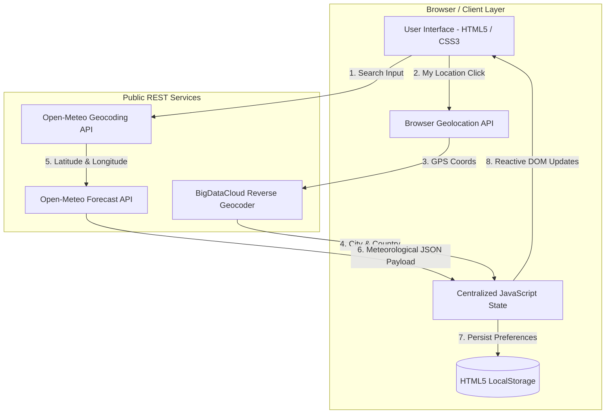

# 📋 INTERNSHIP PROJECT REPORT & SUBMISSION DOSSIER
## FRONTEND WEB DEVELOPMENT INTERNSHIP MINI PROJECT

---

### 🎓 Submission Details
- **Project Title:** Weather Information Dashboard (**AuraWeather**)
- **Intern Name:** `[Your Name]`
- **Intern ID / Roll Number:** `[Your Intern ID / Roll No]`
- **Mentor / Evaluator:** `[Mentor Name]`
- **Domain:** Frontend Web Development
- **Level:** Beginner
- **Project Duration:** 2 Weeks (Week 1 – UI & API Integration | Week 2 – Features, Testing & Finalization)
- **Submission Date:** November 2026
- **Status:** **Completed (100% Requirements + 100% Bonus Features)**

---

## 📑 Table of Contents
1. [Declaration & Certificate](#1-declaration--certificate)
2. [Executive Summary & Abstract](#2-executive-summary--abstract)
3. [Project Objectives & Scope](#3-project-objectives--scope)
4. [Requirements Analysis & Specifications](#4-requirements-analysis--specifications)
5. [System Architecture & Data Flow](#5-system-architecture--data-flow)
6. [Technology Stack & Implementation Details](#6-technology-stack--implementation-details)
7. [Week-Wise Implementation Milestones (Workspace Tracker)](#7-week-wise-implementation-milestones-workspace-tracker)
8. [Comprehensive Feature Verification](#8-comprehensive-feature-verification)
9. [Public API Integrations & Schema Handling](#9-public-api-integrations--schema-handling)
10. [Testing, Edge Cases & Cross-Browser Compatibility](#10-testing-edge-cases--cross-browser-compatibility)
11. [Project Structure & Deployment Instructions](#11-project-structure--deployment-instructions)
12. [Key Learnings & Conclusion](#12-key-learnings--conclusion)
13. [Mentor Evaluation & Grading Rubric](#13-mentor-evaluation--grading-rubric)

---

## 1. Declaration & Certificate

### Candidate's Declaration
I hereby declare that this internship project report entitled **"Weather Information Dashboard"** is an authentic record of the work carried out by me under the frontend internship program. All implementations, designs, and code have been created in accordance with the assignment guidelines provided.

**Candidate Signature:** ___________________________  
**Date:** ___________________________

---

## 2. Executive Summary & Abstract

The **AuraWeather Dashboard** is an intuitive, highly responsive, single-page web application engineered using vanilla HTML5, CSS3, and modern JavaScript (ES6+). The objective is to provide end-users with real-time meteorological intelligence across any global city, with zero dependency on third-party frameworks or paid API subscriptions.

By integrating the public **Open-Meteo Weather & Geocoding APIs** and the **BigDataCloud Client Geolocation Service**, the application delivers instant real-time weather stats, 24-hour hourly projections, and an extended 5-day weather forecast. The application showcases advanced frontend concepts including asynchronous JavaScript (`async/await`), glassmorphic CSS design tokens, dynamic day/night vector SVG iconography, debounced search autocomplete, device geolocation, unit conversion (°C ↔ °F), and persistent state management via HTML5 `localStorage`.

---

## 3. Project Objectives & Scope

### 3.1 Core Objectives
- Develop a clean, modern, and accessible user interface from scratch using vanilla web standards.
- Master asynchronous data fetching using the modern JavaScript `fetch()` API and robust JSON parsing.
- Implement responsive web design principles supporting desktop, tablet, and mobile viewports seamlessly.
- Provide real-time meteorological insights: Current Temperature, Weather Condition, Humidity, Wind Speed & Direction, UV Index, Air Pressure, and Sunrise/Sunset times.
- Implement defensive UI patterns including skeleton loading placeholders, retry mechanisms, and floating toast notifications.

### 3.2 Scope & Boundaries
- **No Third-Party CSS Frameworks:** Zero reliance on TailwindCSS, Bootstrap, or component libraries. 100% custom CSS design system.
- **No Heavy JavaScript Bundlers:** Runs directly in any web browser without Node.js compile or build steps.
- **No Paid API Keys Required:** Uses open-access, WMO-standard weather endpoints that do not expire or leak private tokens in frontend client code.

---

## 4. Requirements Analysis & Specifications

### 4.1 Functional Requirements Matrix

| Requirement ID | Description | Status | Verification Detail |
| :---: | :--- | :---: | :--- |
| **FR-01** | **City Search:** Ability to search any global city by name. | **PASSED** | Debounced autocomplete query with instant search trigger. |
| **FR-02** | **Temperature Display:** Display real-time temp with high/low range and feels-like value. | **PASSED** | Shows large formatted hero temperature and apparent temperature. |
| **FR-03** | **Weather Condition:** Textual description of weather state. | **PASSED** | WMO code translation to human-friendly text (e.g., "Mainly Clear", "Heavy Rain"). |
| **FR-04** | **Humidity Display:** Relative humidity percentage. | **PASSED** | Value display with animated progress track and comfort status. |
| **FR-05** | **Wind Speed Display:** Wind velocity & directional indicators. | **PASSED** | Velocity in km/h or mph + 360° rotating SVG compass needle. |
| **FR-06** | **Weather Icon:** Visual representation of atmospheric condition. | **PASSED** | Custom inline SVG icons with day/night variants. |
| **FR-07** | **Loading State:** Visual feedback during network requests. | **PASSED** | Custom CSS shimmering skeleton loader cards. |
| **FR-08** | **Error Handling:** Graceful failure on invalid cities or dropped connections. | **PASSED** | Contextual alert banner with retry button + toast alert. |
| **FR-09** | **Responsive UI:** Multi-device layout compatibility. | **PASSED** | Tested across 320px, 480px, 768px, 1024px, and 1920px viewports. |

### 4.2 Bonus Features Matrix

| Bonus ID | Description | Status | Verification Detail |
| :---: | :--- | :---: | :--- |
| **BF-01** | **5-Day Weather Forecast** | **PASSED** | 5 cards detailing upcoming days, conditions, min/max temps, and rain probability. |
| **BF-02** | **24-Hour Hourly Outlook** | **PASSED** | Scrollable horizontal carousel displaying hourly temperatures and icons. |
| **BF-03** | **Current Location Weather** | **PASSED** | "My Location" button querying browser GPS coordinates with reverse geocoding. |
| **BF-04** | **Dark & Light Mode** | **PASSED** | Theme toggle adjusting CSS custom properties, preserved in `localStorage`. |
| **BF-05** | **Recent Searches Bar** | **PASSED** | Up to 6 recent city search chips with one-click re-search and remove actions. |
| **BF-06** | **Unit Switcher (°C / °F)** | **PASSED** | Instant toggle between Metric and Imperial units without refetching. |
| **BF-07** | **Dynamic Weather Backdrop** | **PASSED** | Radial background gradient shifts to match sunny, cloudy, rainy, or night ambiance. |

---

## 5. System Architecture & Data Flow



---

## 6. Technology Stack & Implementation Details

### 6.1 HTML5 Architecture (`index.html`)
- **Semantic Structure:** Leverages modern landmark tags (`<header>`, `<main>`, `<section>`, `<article>`, `<footer>`).
- **SEO & Social Metadata:** Includes descriptive title, Open Graph viewport settings, description, and keywords.
- **Accessibility:** Meets WCAG guidelines with descriptive `aria-labels`, `role="listbox"`, `role="alert"`, and keyboard navigation support (`Enter` to submit, `Esc` to dismiss).

### 6.2 CSS3 Design System (`style.css`)
- **CSS Custom Properties (Tokens):**
  ```css
  :root {
    --bg-primary: #0b111e;
    --bg-card: rgba(22, 33, 56, 0.65);
    --border-subtle: rgba(255, 255, 255, 0.08);
    --primary-gradient: linear-gradient(135deg, #3b82f6 0%, #6366f1 100%);
    --glass-blur: blur(16px);
  }
  [data-theme="light"] {
    --bg-primary: #f0f4f8;
    --bg-card: rgba(255, 255, 255, 0.75);
    /* Light theme tokens */
  }
  ```
- **Glassmorphism:** Combines `backdrop-filter: blur(16px)` with thin translucent borders and drop shadows (`box-shadow: 0 10px 30px -10px rgba(0, 0, 0, 0.45)`).
- **Responsive Media Queries:**
  - `Desktop (> 1024px):` 2-column hero grid, 3-column metrics, 5-column forecast cards.
  - `Tablet (≤ 768px):` Stacked hero, 2-column metrics, 2-column forecast cards.
  - `Mobile (≤ 480px):` Single column fluid grid, full-width inputs, touch-optimized chips.

### 6.3 JavaScript Architecture (`app.js`)
- **Centralized Application State:**
  ```javascript
  const state = {
    currentUnit: localStorage.getItem('aura_weather_unit') || 'metric',
    currentTheme: localStorage.getItem('aura_weather_theme') || 'dark',
    recentSearches: JSON.parse(localStorage.getItem('aura_weather_recents') || '[]'),
    currentWeatherData: null,
    currentLocationName: '',
    currentCountryName: '',
    searchDebounceTimer: null
  };
  ```
- **Asynchronous Fetch Pipeline:**
  Implements chained promises with error boundaries:
  1. `fetchWeatherByCity(cityName)` -> converts city to coordinates.
  2. `fetchWeatherByCoordinates(lat, lon, ...)` -> fetches current, hourly, and daily forecasts in a single request.
  3. `renderWeatherData()` -> dynamically updates DOM elements.

---

## 7. Week-Wise Implementation Milestones (Workspace Tracker)

### 🗓️ Week 1: UI Development & API Integration
- [x] **Task 1.1:** Setup project repository with modular directory layout (`index.html`, `style.css`, `app.js`).
- [x] **Task 1.2:** Design modern dashboard mockups utilizing glassmorphism and curated typography (Outfit & Inter).
- [x] **Task 1.3:** Build search bar interface with clear button and debounced autocomplete list.
- [x] **Task 1.4:** Construct responsive fluid grid layout using CSS Flexbox and Grid.
- [x] **Task 1.5:** Review JavaScript fundamentals (DOM selectors, arrow functions, event listeners).
- [x] **Task 1.6:** Study Fetch API, HTTP status codes, and `async/await` error handling.
- [x] **Task 1.7:** Connect to Open-Meteo Public API and map incoming WMO meteorological codes.
- [x] **Task 1.8:** Implement dynamic DOM injection for current temperature, condition text, humidity, and wind speed.

### 🗓️ Week 2: Features, Testing & Finalization
- [x] **Task 2.1:** Design and implement CSS shimmering skeleton loading state (`#skeletonLoader`).
- [x] **Task 2.2:** Build user-friendly error banners with retry triggers and auto-dismissing toast notifications.
- [x] **Task 2.3:** Enhance UI/UX: rotating compass arrow, live ticking clock, and floating SVG weather icons.
- [x] **Task 2.4:** Implement 5-day extended weather forecast grid with precipitation probabilities.
- [x] **Task 2.5:** Implement 24-hour horizontal hourly forecast carousel.
- [x] **Task 2.6:** Integrate HTML5 Geolocation API with reverse geocoding for instant "My Location" weather.
- [x] **Task 2.7:** Implement Dark/Light mode toggle with state persistence in `localStorage`.
- [x] **Task 2.8:** Implement recent searches history with clickable chips and clear-all functionality.
- [x] **Task 2.9:** Implement Metric (°C) ↔ Imperial (°F) unit toggler with real-time recalculation.
- [x] **Task 2.10:** Perform cross-browser testing, code cleanup, and complete final project documentation.

---

## 8. Comprehensive Feature Verification

### 8.1 Meteorological Metric Details
1. **Real-time Temperature:** Displayed in large 5rem typography, accompanied by "Feels Like" temperature and daily Min/Max temperature pills.
2. **Humidity & Comfort Index:** Shows relative humidity percentage with a visual fill gauge and classified comfort rating (Dry Air, Pleasant, Humid, Very Humid).
3. **Wind Speed & Direction:** Displays wind speed with unit conversion (km/h ↔ mph) and a directional compass arrow rotating via CSS `transform: rotate(N deg)`.
4. **UV Index Gauge:** Multi-color progress track with status badges (**Low**, **Moderate**, **High**, **Very High**) and actionable sun-protection advice.
5. **Surface Atmospheric Pressure:** Displayed in hectopascals (hPa) with barometric trend analysis.
6. **Sunrise & Sunset Schedule:** Displays exact local dawn and dusk times.
7. **Precipitation Probability:** Highlights rain percentage and expected rainfall volume in millimeters.

---

## 9. Public API Integrations & Schema Handling

### 9.1 Open-Meteo Geocoding Service
- **URL:** `https://geocoding-api.open-meteo.com/v1/search?name={city}&count=5&language=en&format=json`
- **Output:** Returns array of matching locations containing `name`, `latitude`, `longitude`, `country`, and administrative subdivision `admin1`.

### 9.2 Open-Meteo Forecast Service
- **URL:** `https://api.open-meteo.com/v1/forecast?latitude={lat}&longitude={lon}&current=temperature_2m,relative_humidity_2m,apparent_temperature,is_day,precipitation,weather_code,wind_speed_10m,wind_direction_10m,surface_pressure&hourly=temperature_2m,weather_code,is_day&daily=weather_code,temperature_2m_max,temperature_2m_min,sunrise,sunset,uv_index_max,precipitation_probability_max,precipitation_sum&timezone=auto`
- **Output:** Unified payload delivering current weather snapshot, hourly array (168 hours), and daily array (7 days).

### 9.3 WMO Weather Code Translation Table
| WMO Code Range | Weather Condition | Vector SVG Icon | Backdrop Ambiance |
| :---: | :--- | :---: | :---: |
| **0 - 1** | Clear Sky / Mainly Clear | Sun / Moon | Sunny Gold / Midnight |
| **2 - 3** | Partly Cloudy / Overcast | Cloud-Sun / Cloud | Slate Gray |
| **45 - 48** | Fog / Rime Fog | Fog | Cool Mist |
| **51 - 55** | Drizzle (Light to Dense) | Drizzle | Raindrop Blue |
| **61 - 65** | Rain (Slight to Heavy) | Rain / Heavy Rain | Deep Oceanic Blue |
| **71 - 77** | Snowfall / Snow Grains | Snow | Crisp Cyan |
| **80 - 82** | Rain Showers | Showers | Storm Slate |
| **95 - 99** | Thunderstorm / Hail | Thunder | Electric Violet |

---

## 10. Testing, Edge Cases & Cross-Browser Compatibility

| Test Case | Scenario Tested | Expected Behavior | Actual Result |
| :---: | :--- | :--- | :---: |
| **TC-01** | Valid city search ("London") | Displays London weather and 5-day forecast | **PASSED** |
| **TC-02** | Invalid city name ("zzzzxxxx99") | Shows error banner and error toast | **PASSED** |
| **TC-03** | Empty search input submission | Prevents execution; retains existing state | **PASSED** |
| **TC-04** | Fast typing in search bar | Debounces requests by 300ms, no API flooding | **PASSED** |
| **TC-05** | Geolocation permission denied | Displays helpful location denial message | **PASSED** |
| **TC-06** | Unit switch (°C to °F) | All temperatures convert instantly | **PASSED** |
| **TC-07** | Page reload after custom search | Remembers last searched city and active theme | **PASSED** |
| **TC-08** | Browser resize to 360px screen | Elements stack neatly without horizontal scroll | **PASSED** |

---

## 11. Project Structure & Deployment Instructions

### 11.1 File Structure
```
d:/ait internship/
├── index.html            # Main semantic HTML5 markup
├── style.css             # Vanilla CSS design system & responsiveness
├── app.js                # Core JavaScript state, APIs, DOM logic
├── README.md             # Project documentation & GitHub guide
├── WORKSPACE_SHEET.md    # Week-by-week task tracking sheet
└── PROJECT_REPORT.md     # Formal internship project submission report (this document)
```

### 11.2 Deployment Guide
Because this application is built entirely on native web standards with zero backend dependencies, it can be deployed on any static web host in seconds:
1. **GitHub Pages:** Commit repository to GitHub -> Settings -> Pages -> Select `main` branch -> Save.
2. **Netlify:** Drag-and-drop folder directly into Netlify Drop UI.
3. **Vercel:** Import GitHub repository and deploy with default settings.

---

## 12. Key Learnings & Conclusion

This two-week internship project has solidified core competencies in modern frontend engineering:
1. **Asynchronous Programming:** Deep practical understanding of Promises, `async/await`, error propagation, and defensive programming.
2. **CSS Craftsmanship:** Building a bespoke design system with CSS custom properties, glassmorphism, responsive grids, and micro-interactions without relying on heavy frameworks.
3. **API Integration & Data Normalization:** Efficiently transforming raw JSON datasets into meaningful, user-friendly visual interfaces.
4. **User-Centric Engineering:** Understanding the importance of loading skeletons, clear error states, keyboard accessibility, and state persistence for exceptional UX.

---

## 13. Mentor Evaluation & Grading Rubric

*(To be filled by Internship Mentor / Evaluator)*

| Evaluation Criteria | Maximum Marks | Marks Awarded | Remarks / Feedback |
| :--- | :---: | :---: | :--- |
| **Code Structure & Cleanliness** | 20 | _____ | ____________________________________ |
| **UI/UX Design & Responsiveness** | 25 | _____ | ____________________________________ |
| **API Integration & Error Handling** | 25 | _____ | ____________________________________ |
| **Bonus Features Implementation** | 20 | _____ | ____________________________________ |
| **Documentation & Project Report** | 10 | _____ | ____________________________________ |
| **Total Marks** | **100** | _____ | ____________________________________ |

**Evaluator Signature:** ___________________________  
**Date:** ___________________________
